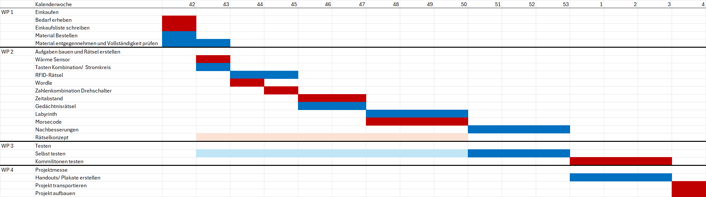

# Puzzle-Pi

Das Projekt ist die Erstellung von interaktiven Rätseln, die mithilfe von physischen Komponenten wie Motor, Schalter, Lampen etc. gelöst werden sollen. Außerdem sollen noch digitales Rätsel, mit dem über einen Bildschirm und Eingabegeräte interagiert werden kann. erstellt werden.
Puzzle-Pi soll Spaß machen und kognitive, wie kreative Fähigkeiten fördern.

# Anforderung

Dieses Projekt hat die Anforderung ein IoT-Projekt mit Verwaltungsbezug zu werden.
Zuerst, was bedeutet IoT: „Das Internet of Things (IoT, Internet der Dinge) ist ein Netzwerk aus miteinander verknüpften Objekten und Geräten („Dinge“ genannt), die mit Sensoren (und anderen Technologien) ausgestattet sind, um Daten zu und von anderen Dingen und Systemen zu übertragen und zu empfangen.“
(Quelle: Was ist das Internet of Things? | SAP. (o. D.). [https://www.sap.com/germany/resources/what-is-iot](https://www.sap.com/germany/resources/what-is-iot) (20.102026))

Um aus diesem Projekt ein IoT-Projekt zu machen, werden einige Grundvoraussetzungen festgelegt. Physische Geräte, die mit Sensoren und anderen Technologien ausgestattet sind werden über ein Raspberry Pi gesteuert, bzw. gilt der Raspberry Pi als Verbindungsstück. Dafür wird in diesem Projekt ein Raspberry Pi 4 und ein RPi 5 genutzt.
Für die Systeme, die Daten empfangen und übertragen sollen, soll ein Server bei der BW-Cloud aufgesetzt und genutzt werden.
Einen Verwaltungsbezug herzustellen ist prinzipiell vielfältig möglich. Hier ein kleiner Überblick über mögliche Einsatzbereiche und Vorteile durch den Einsatz von IoT Technologien für Kommunen:

- Intelligente Straßenbeleuchtung, passt sich an Umgebung und Bedarf an.
Effizienzsteigerung, Nachhaltigkeit und Kosteneinsparungen

- Intelligentes Abfallsystem, Füllstand von Müllcontainern wird durch Sensoren gemessen.
Kosteneinsparung, durch Vermeidung unnötiger Fahrten

- Des weiteren haben Kommunen durch Echtzeitdaten aus IoT Systemen die Möglichkeit eine fundierte Entscheidungsgrundlage zu nutzen.

(Quelle: Vorteile von IoT für Kommunen. Alpha-Omega Technology GmbH & Co. KG. (o. D.). https://iot-market.eu/vorteile-fur-kommunen (20.10.2026))

## Was muss unser Escaperoom-Projekt leisten um die Anforderungen zu erfüllen?

Die Anforderung, dass physische Geräte Zustände erfassen, Daten verarbeiten und über ein Netzwerk mit anderen Systemen kommunizieren, kann bei unserem Projekt durch die Kombination verschiedener elektronischer Rätsel, eines Raspberry Pi und eines Servers in der BW-Cloud umgesetzt werden.

Bei unserem Projekt geht es darum, dass eine oder mehrere Personen mehrere miteinander verbundene Rätsel lösen, um ein bestimmtes Ziel zu erreichen. 
Bei einem klassischen Escape Room besteht dieses Ziel beispielsweise darin, einen verschlossenen Raum zu verlassen. 
In unserem Projekt kann das Ziel alternativ darin bestehen, eine verschlossene Box zu öffnen, ein digitales System freizuschalten oder einen fiktiven Verwaltungsvorgang erfolgreich abzuschließen.

Die einzelnen Rätsel werden mithilfe physischer und digitaler Komponenten realisiert. Dabei sollen die Spieler sowohl mit realen Gegenständen und Sensoren interagieren als auch Aufgaben lösen, die auf einem digitalen System bereitgestellt werden.

Die Anforderungen an ein IoT-Projekt werden durch folgende Komponenten erfüllt:
-	Physische Geräte: Sensoren und Eingabegeräte erfassen die Aktionen der Spieler und Zustände der Umgebung (z.B. Taster, RFID-leser, DHT 22 Sensoren).
-	Datenverarbeitung: Der Raspberry Pi verarbeitet die erfassten Daten (oder leitet sie an den Server weiter, wo sie verarbeitet werden) und prüft, ob die Bedingungen eines Rätsels erfüllt sind.
-	Netzwerkkommunikation: Der Raspberry Pi überträgt Informationen an den BW-Cloud-Server und empfängt gegebenenfalls Antworten oder neue Aufgaben. Die Antworten des Servers können auch zu physischen Aktionen führen, wie das Öffnen einer Box.
-	Digitale Anwendung: Eine Anwendung auf dem BW-Cloud-Server kann Rätsel bereitstellen, Ergebnisse prüfen oder den aktuellen Spielfortschritt verwalten.
  
Entscheidend ist dabei, dass die Komponenten nicht nur unabhängig voneinander funktionieren, sondern miteinander kommunizieren und gemeinsam den Spielfortschritt steuern.

Einen Nutzen für die öffentliche Verwaltung zu zeigen, kann durch einzelne Rätsel geschafft werden.
- RFID-Leser: Zugangskontrolle für Mitarbeiter, durch RFID-Chipkarten
- DHT22: Klimaüberwachung in öffentlichen Gebäuden

Der „Escape Room“ könnte außerdem von der Gestaltung auf die Verwaltung ausgerichtet sein. Vorstellbar wäre die Rätsel sind für die Bearbeitung eines Verwaltungsvorganges zu lösen (Die Rätsel stellen Daten für die Entscheidungsgrundlage da) oder auch als Spielidee ein gehacktes Verwaltungssystem muss über die Rätsel nach und nach freigeschalten werden.

# Projektteam

Paul Löffler - Product Owner, Developer

Yannic Ibach - Scrum Master, Developer

# Work Packages

## 1 Einkaufen

Zu beginn werden, bzw. wurden die benötigten Komponenten, anhand der geplanten Tasks, ermittelt.

Die Komponenten werden Bestellt oder in einem Elektrofachmarkt gesucht und gekauft.

## 2 Aufgaben bauen und Rätsel erstellen

Die geplanten Rätsel werden technisch gebaut und zusammenhängende Rätsel erstellt.

Siehe "Rätsel - Übersicht und Umsetzung" für Details

## 3 Testen

Getestet werden die einzelnen Aufgaben nach ihrer Umsetzung und zum Schluss als zusammenhängendes Ganzes.

Eine weitere Testphase mit am Projeklt unbeteiligten ist vor der Projektmesse geplant. Beteiligte können Kommilitonen, Freunde oder Familie sein.

## 4 Projektmesse

Um sich auf die Projektmesse vorzubereiten werden Plakate, Handouts oder anderes passende Infomaterial zum Projekt erstellt.

Letztlich muss das Projekt transportiert werden, vor Ort sicher aufgebaut und nocheinmal die Funktionsfähigkeit überprüft werden.

# Rätsel – Übersicht und Umsetzung

## 1. Wärmesensor

### Beschreibung
Der Spieler muss den Sensor eine bestimmte Temperatur messen lassen, um den nächsten Hinweis zu erhalten.

### Material
- DHT22-Temperatursensor
- Föhn (optional)
- Lämpchen zur Anzeige des Erfolgs

---

## 2. Tastenkombination

### Beschreibung
Der Spieler muss mithilfe von drei Knöpfen eine bestimmte Kombination eingeben:

- **Knopf 1:** 3-mal drücken
- **Knopf 2:** 2-mal drücken
- **Knopf 3:** 5-mal drücken

Bei jedem richtigen Schritt leuchten Lämpchen auf. Wenn die Kombination korrekt ist, öffnet sich eine Box mit dem nächsten Hinweis.

### Material
- Taster bzw. Knöpfe
- Lämpchen
- Kabel und Stecker
- Widerstände
- Relaismodul
- Motor
- Box

---

## 3. RFID-Rätsel

### Beschreibung
Drei Objekte mit eingebauten RFID-Chips müssen an die jeweils richtige Stelle mit einem RFID-Lesegerät gelegt werden.

### Material
- RFID-Modul
- RFID-Tags oder -Token
- Drei Objekte

---

## 4. Wordle

### Beschreibung
Der Spieler muss ein Wort erraten, ähnlich wie im Spiel Wordle. Die Umsetzung erfolgt in Python.

### Material
- Bildschirm
- Tastatur oder andere Eingabemöglichkeit
- Computer oder Raspberry Pi
- Python
- Optional: Pygame

---

## 5. Zahlenkombination mit Drehschaltern

### Beschreibung
Der Spieler muss Drehschalter in die richtige Position bringen. Die korrekten Positionen werden durch ein Audiosignal vermittelt.

### Material
- Drehschalter
- Lautsprecher
- Potentiometer
- Steuerungseinheit

---

## 6. Zeitabstand

### Beschreibung
Der Spieler muss eine bestimmte Tastenkombination innerhalb eines Zeitlimits eingeben.

### Material
- Taster bzw. Knöpfe
- RTC-Modul (optional)
- Display
- Steuerungseinheit

---

## 7. Gedächtnisrätsel

### Beschreibung
Verschiedenfarbige Lämpchen leuchten in einer vorgegebenen Reihenfolge auf. Der Spieler muss sich die Reihenfolge merken und anschließend korrekt wiedergeben.

### Material
- Verschiedenfarbige Lämpchen oder LEDs
- Knöpfe bzw. Taster
- Widerstände
- Steuerungseinheit

---

## 8. Labyrinth

### Beschreibung
Der Spieler muss sich durch ein Labyrinth navigieren, das auf einem Bildschirm angezeigt wird.

Die Umsetzung erfolgt in Python mithilfe von Pygame als zweidimensionale Ansicht.

Der Schwierigkeitsgrad kann durch folgende Elemente angepasst werden:

- Fallen
- Schlüssel und verschlossene Türen
- Fog of War (nicht erkundete Bereiche sind zunächst unsichtbar)
- Unterschiedliche Labyrinthgrößen
- Zeitlimit

### Material
- Bildschirm
- Computer oder Raspberry Pi
- Tastatur oder Controller
- Python
- Pygame

---

## 9. Morsecode

### Beschreibung
Der Spieler erhält über eine Lampe oder einen Lautsprecher lange und kurze Signale. Diese müssen mithilfe eines Morsecode-Hinweisblatts entschlüsselt werden.

### Material
- Lampe oder LED
- Lautsprecher (optional)
- Morsecode-Hinweisblatt
- Steuerungseinheit (optional)v

#

# Gantt-Diagramm

## Zuständigkeit:

Rot - Paul Löffler

Blau - Yannic Ibach

