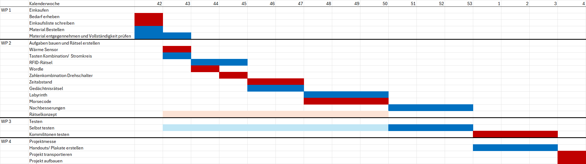

# Escape Room mit Raspberry Pi

Das Projekt ist die Erstellung von interaktiven Rätseln, die mithilfe von physischen Komponenten wie Motor, Schalter, Lampen etc. gelöst werden sollen. Außerdem soll noch ein digitales Rätsel, mit dem über einen Bildschirm und Eingabegeräte interagiert werden kann. erstellt werden.

# Workpackages

# Rätsel – Übersicht und Umsetzung

## 1. Wärmesensor

### Beschreibung
Der Spieler muss den Sensor eine bestimmte Temperatur messen lassen, um den nächsten Hinweis zu erhalten.

### Material
- DHT22-Temperatursensor
- Föhn (optional)
- Lämpchen zur Anzeige des Erfolgs

---

## 2. Tastenkombination

### Beschreibung
Der Spieler muss mithilfe von drei Knöpfen eine bestimmte Kombination eingeben:

- **Knopf 1:** 3-mal drücken
- **Knopf 2:** 2-mal drücken
- **Knopf 3:** 5-mal drücken

Bei jedem richtigen Schritt leuchten Lämpchen auf. Wenn die Kombination korrekt ist, öffnet sich eine Box mit dem nächsten Hinweis.

### Material
- Taster bzw. Knöpfe
- Lämpchen
- Kabel und Stecker
- Widerstände
- Relaismodul
- Motor
- Box

---

## 3. RFID-Rätsel

### Beschreibung
Drei Objekte mit eingebauten RFID-Chips müssen an die jeweils richtige Stelle mit einem RFID-Lesegerät gelegt werden.

### Material
- RFID-Modul
- RFID-Tags oder -Token
- Drei Objekte

---

## 4. Wordle

### Beschreibung
Der Spieler muss ein Wort erraten, ähnlich wie im Spiel Wordle. Die Umsetzung erfolgt in Python.

### Material
- Bildschirm
- Tastatur oder andere Eingabemöglichkeit
- Computer oder Raspberry Pi
- Python
- Optional: Pygame

---

## 5. Zahlenkombination mit Drehschaltern

### Beschreibung
Der Spieler muss Drehschalter in die richtige Position bringen. Die korrekten Positionen werden durch ein Audiosignal vermittelt.

### Material
- Drehschalter
- Lautsprecher
- Potentiometer
- Steuerungseinheit

---

## 6. Zeitabstand

### Beschreibung
Der Spieler muss eine bestimmte Tastenkombination innerhalb eines Zeitlimits eingeben.

### Material
- Taster bzw. Knöpfe
- RTC-Modul (optional)
- Display
- Steuerungseinheit

---

## 7. Gedächtnisrätsel

### Beschreibung
Verschiedenfarbige Lämpchen leuchten in einer vorgegebenen Reihenfolge auf. Der Spieler muss sich die Reihenfolge merken und anschließend korrekt wiedergeben.

### Material
- Verschiedenfarbige Lämpchen oder LEDs
- Knöpfe bzw. Taster
- Widerstände
- Steuerungseinheit

---

## 8. Labyrinth

### Beschreibung
Der Spieler muss sich durch ein Labyrinth navigieren, das auf einem Bildschirm angezeigt wird.

Die Umsetzung erfolgt in Python mithilfe von Pygame als zweidimensionale Ansicht.

Der Schwierigkeitsgrad kann durch folgende Elemente angepasst werden:

- Fallen
- Schlüssel und verschlossene Türen
- Fog of War (nicht erkundete Bereiche sind zunächst unsichtbar)
- Unterschiedliche Labyrinthgrößen
- Zeitlimit

### Material
- Bildschirm
- Computer oder Raspberry Pi
- Tastatur oder Controller
- Python
- Pygame

---

## 9. Morsecode

### Beschreibung
Der Spieler erhält über eine Lampe oder einen Lautsprecher lange und kurze Signale. Diese müssen mithilfe eines Morsecode-Hinweisblatts entschlüsselt werden.

### Material
- Lampe oder LED
- Lautsprecher (optional)
- Morsecode-Hinweisblatt
- Steuerungseinheit (optional)v

#

# Gantt-Diagramm

